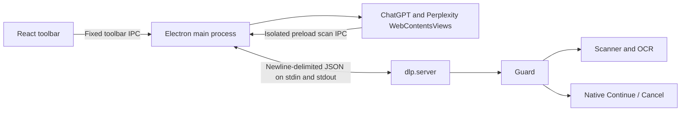

# Architecture

Walled DLP checks composer submissions and file attachments inside the embedded ChatGPT and Perplexity
pages. The desktop app uses Electron, React and TypeScript. The Python backend owns the inspection
policy, scanner, OCR and native dialogs.

## Browser and IPC boundaries

- Each site gets a sandboxed `WebContentsView` and a persistent Chromium session. Tabs keep their
  page and history when hidden. Back, Forward and Reload act on the selected view.
- Top-level navigation, redirects and history entries follow each site's URL allowlist. Electron
  denies new windows and can reuse the current view for allowlisted links. The isolated preload
  asks main to open clicked external HTTPS links in the system browser.
- The toolbar has a fixed API in `preload-shell.ts`. Main checks the document, main frame and
  sender before accepting toolbar commands. Toolbar state includes the site host. The website
  preload keeps its IPC calls in the isolated world and main validates the active view, origin,
  frame and payload before scanning. Test-mode backend options require two loopback mock sites.
- Electron starts `python -u -m dlp.server` from `server/`. Private pipes carry requests with
  unique IDs and bounded message sizes. The manager correlates replies and enforces deadlines.
  Python reserves stdout for protocol messages and sends content-free diagnostics to stderr.
- The manager validates the `ready` event, child PID, protocol version and configured marker before
  reporting readiness. Crashes and request timeouts restart Python with backoff. Outstanding
  inspections are rejected, and closing the pipe lets Python dismiss any open confirmation. App quit
  requests shutdown and waits for exit, with forced termination after a grace period.
- The packaged executable disables Electron's RunAsNode, Node environment options and inspector fuses.

## Prompt interception

The sandboxed preload installs the shared `inject/guard.js` capture listeners before site scripts
run. Enter, Send and native submit events follow the normal site path when the draft lacks the marker.
For a marked draft:

1. Hold the submission and send the exact text to Python. Overlapping Enter, click and submit events
   share one pending decision. Ambiguous form or button ownership blocks a marked submission.
2. `Guard.on_prompt` scans the text and asks the user through the native dialog on a match.
3. An explicit allow permits one replay if the draft and destination still match. Switching tabs or
   navigating invalidates outstanding approvals. Cancel or a bridge or scan error keeps the draft in
   the composer.

## File interception

Hooks on the three ways a file can enter the page: `<input type=file>` (`input` + `change`), `drop`, `paste`.

1. The event is held while each file is read into memory. The file operation sends
   `{kind:'file', name, mimeType, size, b64}` to Python. The scanner classifies the file
   using its existing byte and filename checks. Files over 30 MiB are blocked before reading.
2. `Guard.on_file` scans in a worker thread (OCR is CPU-bound) so the event loop stays responsive.
3. A marker hit opens the native dialog for that file. **Continue** keeps it in the current selection.
   **Cancel** drops it. Read, decode and scan failures also block the file.
4. The guard replays a fresh `DataTransfer` containing only the file snapshots Python approved.
   A picker selection is held across its paired `input` and `change` events, and a newer
   selection replaces the pending one. A drop directly on a file input uses the same path.
   Text-only paste follows the normal browser path. Recognised inline binary clipboard data and
   local file references without an inspectable `File` are blocked.

Multi-select works per file: one sensitive file in a selection of three drops only that one.

## Detection (`scanner.py`)

The scanner prefers file signatures. It uses supported filename extensions to catch corrupt files
whose signatures are missing.

| Type | Strategy |
|---|---|
| text | Raw byte search for the marker in UTF-8 / UTF-16 LE / BE |
| PDF | `pypdf` text per page + metadata → OCR of embedded images → pages with little extractable text or painted vector paths are rendered by `pypdfium2` and scanned with OCR |
| image | Raw metadata scan and OCR (rapidocr, Tesseract fallback), including every frame within the scan limit |
| docx/xlsx/pptx/zip | members are scanned by type, including PDFs, images, and nested archives within work limits. Office text runs are joined within the same paragraph or cell |

Text from PDF extraction and OCR is matched tolerantly (`WALLED[ _.-]{0,3}SENSITIVE`) since both routinely
mangle underscores. Typed prompts and plain text use the exact marker. Encrypted PDFs, PDFs with
embedded files, unsupported binary formats, parser or OCR errors, and incomplete scans due to work limits return errors and block
the upload. The scanner also caps decoded image and rendered PDF page sizes at 25 million pixels and
checks at most 10,000 archive entries across a file and its nested archives.

## Native dialog

`confirm(Detection)` is blocking and returns Continue/Cancel. It states **prompt vs file**, the
**destination site**, and a **prompt or file name preview** (plus type, size and *where* the marker
was found), with buttons labelled *Continue* and *Cancel*. Default focus depends on the native helper.

* macOS: `osascript` `display dialog` - a real system dialog.
* Linux: `zenity`, else `kdialog`. Windows (and any fallback): a Tk window in a child process.

Dialogs run in a worker thread behind an `asyncio.Lock`. One confirmation is open at a time. A helper
that fails to display or answer within 90 seconds blocks the action.

## Response colour

`guard.js` adopts one stylesheet per site document. Its rules match assistant answers and their
descendants as streamed content appears. User messages and composers are excluded along with
their enclosures, so they retain the site's colours. The Electron build bundles the response
settings from `config.py` into the site preload. The toolbar uses a separate document and preload.

## Backend protocol and maintenance

`dlp.server` supports `ping`, `prompt`, `file`, `request`, `init_script` and `shutdown`.
Inspection results carry an `allow` boolean and a structured error when inspection fails.
`request` inspects JSON bytes explicitly supplied by a caller. The desktop UI guards composer
and attachment events through its preload. `init_script` packages the shared hooks and
configuration for IPC callers, and the Electron build bundles that same guard into its preload.

The backend can be launched from `server/` for independent inspection. Its checks cover the
scanner, guard, dialogs and stdio protocol. The JavaScript browser driver belongs to the
desktop end-to-end harness. The app creates and controls its embedded views with Electron APIs.

## Coverage limits

- The guard covers the configured top-level site composers and attachment events. Site-owned network
  requests, direct `form.submit()` calls, subframes, and controls outside those selectors can fall
  outside that coverage. Site markup changes can also affect response colouring.
- Approved DOM actions use replay events. Sites that require browser-trusted events or rely on the
  browser's default drop or paste behaviour may reject the replay. Replayed file transfers carry the
  approved file items, and text-only paste follows the original path.
- Both tabs start on public home pages. Recognised sign-in destinations require a trusted sign-in
  action in the selected tab or a continuation from an already open sign-in page. The Google sign-in
  dialog defaults to returning to the site's form. It can open only the site's public home page in
  the default browser. That browser owns its own session and sits outside the DLP guard. The
  embedded tab's session changes only through authentication performed by the site in that tab.
  Other methods depend on the site's account rules and may require a separate popup or unlisted
  provider. Each site controls which features it makes available to guests.
- OCR coverage depends on image quality and what the engine recognises. Painted vector paths trigger
  PDF rendering even when text extraction succeeds. The 15-page rendering limit can block long,
  graphics-heavy PDFs.
- Linux and Tk dialog helpers receive preview text as an argument visible to local process inspection.
  The macOS helper receives its preview through stdin.
